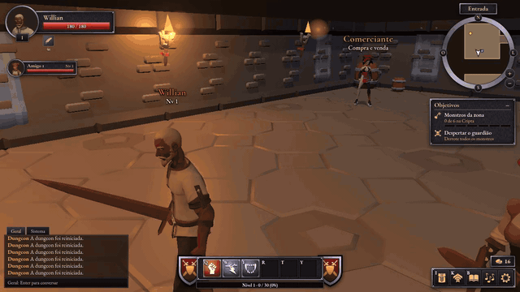

### Hi, I'm Willian 👋

**Senior Backend & AI Engineer.** I build complete products: Go and Node.js services on AWS, AI agents that hold up
in production, and real-time systems, from the first design doc to the deploy. Based in Salvador, Brazil (UTC-3),
working remotely.

#### What I build

- **[Nehva CRM](https://github.com/Willianwg/nehva-crm-case-study).** A WhatsApp & Instagram inbox for small stores, designed, built and run solo. It
  is a multi-tenant TypeScript backend with a webhook worker, a transactional outbox and a public API. It is a
  registered Meta Tech Provider, with WhatsApp Business messaging approved by Meta.
- **[Cobrowser](https://github.com/Willianwg/cobrowser-case-study).** An autonomous browser agent built for cost and reliability: loop diagnosis from
  traces, a fail-safe fast path, token reduction, Langfuse observability, and an MCP server.
- **Real-time 3D co-op game.** A browser multiplayer game for 3 players, with Three.js and WebSocket sync, deployed
  with Docker.

#### Open source

- **[Activepieces](https://github.com/activepieces/activepieces/pulls?q=is%3Apr+author%3Awillianwg+is%3Amerged)**: 9 merged
  PRs adding integrations: VTEX, PostgreSQL, Amazon S3, StabilityAI, XML, MailerLite, and OpenAI roles support.

#### How I work

Spec first, then a plan, then implementation with AI coding agents (Claude Code), backed by automated tests and
review.

#### Stack

`Go` `TypeScript` `Node.js` `NestJS` `Hono` `Python` `AWS` `PostgreSQL` `Redis` `Docker` `Terraform`
`LangChain` `RAG` `MCP` `Playwright` `React` `Three.js`

#### Contact

[LinkedIn](https://www.linkedin.com/in/willian-guedes) · willian.wg70@gmail.com
